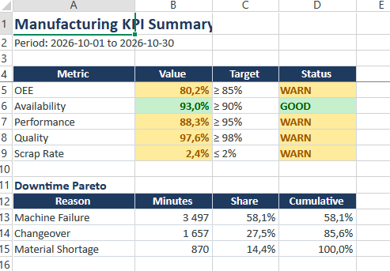
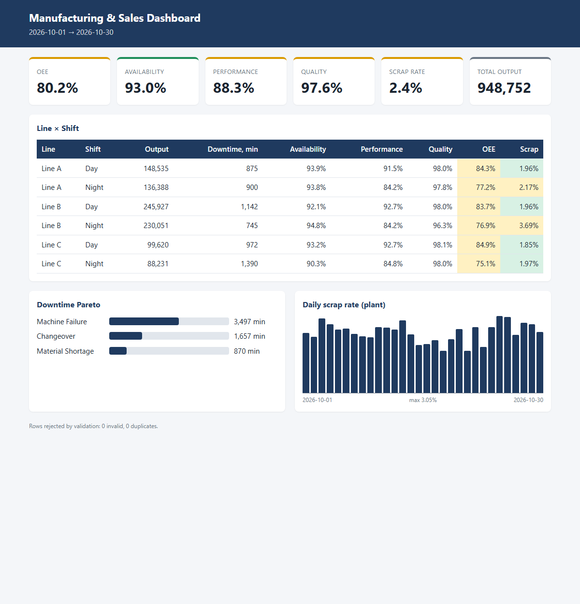

# Manufacturing & Sales Automated Reporting Pipeline

Every week someone merges shift logs into Excel, recalculates OEE by hand and rebuilds the same charts. This pipeline replaces that: raw production data goes in, a validated SQLite database, an executive Excel workbook and a standalone HTML dashboard come out. One command, about a second. It saves **5+ hours of manual reporting per week**.

## What you get

| Output | Contents |
|---|---|
| `reports/executive_report.xlsx` | KPI summary with green/yellow/red status, downtime Pareto, Line × Shift table, scrap-rate line chart, frozen headers |
| `reports/dashboard.html` | Responsive dashboard: KPI cards, colour-coded Line × Shift table, Pareto bars, daily scrap chart. CSS is inlined, no CDN, works offline |
| `production.db` | Validated data in SQLite table `production` |




*(placeholders: run the pipeline and replace with your own screenshots)*

## Quick start

```bash
python -m venv .venv && .venv\Scripts\activate   # Linux/macOS: source .venv/bin/activate
pip install -r requirements.txt
python main.py --generate-mock
```

Use your own data: `python main.py --csv my_data.csv`. Required columns:
`date, line, shift, planned_time_min, downtime_min, downtime_reason, ideal_rate, total_output, defects`.

Tests: `python -m unittest`

## Architecture

```
mfg-reporting/
├── main.py                 # CLI entry point
├── generate_data.py        # 30 days of mock data, 3 lines × 2 shifts
├── pipeline.py             # validation, SQLite load, OEE / scrap / Pareto
├── reporters/
│   ├── excel_reporter.py   # openpyxl workbook
│   └── html_reporter.py    # jinja2 standalone dashboard
├── tests/test_pipeline.py
└── requirements.txt        # pandas, openpyxl, jinja2
```

Flow: `CSV → validate → SQLite → metrics → Excel + HTML`.

**Metrics.** Availability = (planned − downtime) / planned. Performance = output / (run time × ideal rate), capped at 100%. Quality = 1 − defects / output. OEE = A × P × Q. Ratios are computed from summed volumes, never by averaging row percentages, so aggregates stay correct.

**Validation.** Duplicate (date, line, shift) rows, missing or negative values, zero planned time, downtime above planned time and defects above output are dropped and counted in the run summary.

**Status thresholds** (OEE 85/65%, scrap 2/4%, etc.) live in one `TARGETS` dict in `pipeline.py`.

## Where it fits

The same pattern, with source data in a CSV or database export and KPIs in a fixed format, applies to enterprise manufacturing and retail reporting (LEGO-style multi-line plants, Ravapi, retail chains): weekly executive packs, shift handover reports, plant-to-plant comparisons. No servers, no licences, runs on any laptop or scheduler.
